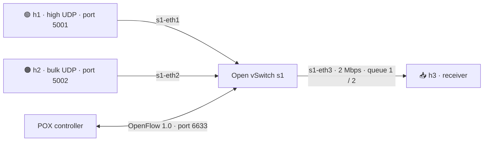

<div align="center">

# 🚦 QoS Traffic Management System

### Dynamic UDP flow prioritization with SDN

[](#)
[](#)
[](#)
[](#)

**Project 5 · SDN Socket Programming**

[🚀 Start here](#-quick-start) · [🧠 How it works](#-how-it-works) · [📈 Results](#-experiment-results) · [🛠 Troubleshooting](#-troubleshooting)

</div>

---

## 👥 Team 14

| Member | Student ID |
|---|---|
| Neha Maravalli | PES2UG25CS721 |
| Sridatta Bharadhwaj M | PES2UG25CS700 |
| Samarth Shivashimpar | PES2UG26CS818 |

## 🎯 What are we building?

A small virtual network sends two kinds of UDP traffic through a bandwidth-limited switch:

- 🟢 **High priority** — VoIP-like packets where delay matters
- 🟠 **Bulk traffic** — background transfer that can tolerate slower service

A **POX SDN controller** watches switch-port counters. When utilization crosses a threshold, it directs the two UDP classes into separate Open vSwitch queues. The switch applies the queue scheduling.

> [!NOTE]
> The controller chooses the queue; Open vSwitch schedules packets. A queue assignment by itself is not proof of a guaranteed bandwidth. We report measured behavior and configured queue limits separately.

## 📚 Contents

- [How it works](#-how-it-works)
- [Network layout](#-network-layout)
- [Quick start](#-quick-start)
- [Run experiments](#-run-experiments)
- [Experiment results](#-experiment-results)
- [Repository map](#-repository-map)
- [Troubleshooting](#-troubleshooting)
- [Team workflow](#-team-workflow)

## 🧠 How it works

1. **Generate:** Python UDP senders create high and bulk traffic.
2. **Measure:** The receiver records sequence numbers and send timestamps. It reports loss only when it receives the sender's end marker; otherwise loss is unknown.
3. **Monitor:** POX polls the receiver-facing OVS port every 2 seconds.
4. **React:** At **≥70% utilization**, the controller activates queue actions. It clears the policy below **50%**.
5. **Compare:** CSV output reports throughput, packet loss, mean delay, and p95 delay.

The gap between the 70% and 50% thresholds is hysteresis; it helps avoid rapid switching near one threshold.

## 🗺 Network layout



## 🚀 Quick start

> Run these commands **inside the Ubuntu VM**. Open separate terminal windows for the controller and Mininet.

<details open>
<summary><strong>1 · Start the SDN controller</strong></summary>

```bash
cd ~/cn-project-/cn-project-
# Ensure port 6633 is free before launching the controller.
PYTHONPATH="$PWD/src" python3 ~/pox/pox.py qos_controller
```

Leave this terminal open. A successful start logs **“QoS controller ready”**; when Mininet connects, it logs **“Switch 1 connected”**.

</details>

<details>
<summary><strong>2 · Start the Mininet topology</strong></summary>

In a second VM terminal:

```bash
cd ~/cn-project-/cn-project-
sudo mn -c
sudo python3 src/mininet_topology.py
```

At the `mininet>` prompt, check reachability:

```text
pingall
```

</details>

## 📈 Run experiments

At the `mininet>` prompt, run one command at a time. The Python prompt `py` lets you run a command on a selected Mininet host; shell commands entered directly at the prompt can be misread as Mininet commands.

<details>
<summary><strong>Collect a run (receiver, then senders)</strong></summary>

Start the receiver and wait two seconds:

```text
py h3.cmd("python3 /home/link/cn-project-/cn-project-/src/traffic.py receive --seconds 35 --measure-seconds 30 --csv /tmp/qos-run.csv > /tmp/qos-receiver.log 2>&1 &")
py __import__('time').sleep(2)
```

Start both senders:

```text
py h1.cmd("python3 /home/link/cn-project-/cn-project-/src/traffic.py send --traffic-class high --seconds 30 --rate-mbps 1.5 >/tmp/high-run.log 2>&1 &")
py h2.cmd("python3 /home/link/cn-project-/cn-project-/src/traffic.py send --traffic-class bulk --seconds 30 --rate-mbps 8 >/tmp/bulk-run.log 2>&1 &")
```

After the run finishes, read the receiver results:

```text
py print(h3.cmd('cat /tmp/qos-run.log; cat /tmp/qos-run.csv'))
```

To verify queue selection while traffic is flowing:

```text
sh ovs-ofctl -O OpenFlow10 dump-flows s1
```

Look for UDP destination port **5001** with `enqueue:"s1-eth3":1`, and port **5002** with `enqueue:"s1-eth3":2`.

</details>

<details>
<summary><strong>Baseline vs QoS: important run labeling</strong></summary>

- **Baseline:** start the POX learning-switch component `forwarding.l2_learning`, not `qos_controller`; run the same topology and traffic rates.
- **QoS:** start `qos_controller`; the flow dump should show queue 1 / queue 2 actions during the run.
- Do not run two POX controllers on port **6633** at the same time.
- Use fresh CSV names for each trial. Record controller logs and actual sender packet counts. Check `end_marker_received`; when it is `false`, the receiver cannot know the missing tail, so use sender totals or repeat the run.
- Repeat at least three comparable trials per condition when possible.

> [!WARNING]
> The run saved as `baseline3.csv` showed QoS queue actions and is excluded from baseline averages. Baseline stress run 4 showed normal `output` actions, but the receiver missed end markers; its receiver-reported 0% loss is invalid. See `results/ANALYSIS.md` and `results/baseline4_reconciled.csv`.

</details>

## 📊 Experiment results

The detailed measurements and caveats are in **[`results/ANALYSIS.md`](results/ANALYSIS.md)**. CSV files are in the same folder.

A preliminary load-matched comparison showed lower high-priority delay and higher bulk delay under QoS. The sample is small and VM traffic rates varied, so treat it as a demonstration—not a final statistical claim. Stress runs showed higher bulk packet loss when demand exceeded available capacity.

> [!TIP]
> For a fair result, hold offered load and run duration constant, verify which controller is active, then compare repeated baseline and QoS trials.

## 🗂 Repository map

| Path | Purpose |
|---|---|
| `src/traffic.py` | UDP sender/receiver and CSV measurements |
| `src/mininet_topology.py` | Three-host Mininet and shaped OVS bottleneck |
| `src/qos_controller.py` | POX learning switch, port-stat polling, adaptive queue policy |
| `docs/SETUP_AND_EXPERIMENT.md` | Full setup, commands, and experiment procedure |
| `results/ANALYSIS.md` | Recorded results, interpretation, and limitations |
| `results/*.csv` | Per-run measurements |
| `TEAM_WORKLOG.md` | Shared progress, errors, tasks, and next steps |

## 🛠 Troubleshooting

<details>
<summary><strong>“Address already in use” on port 6633</strong></summary>

Find the process holding the controller port:

```bash
sudo ss -ltnp 'sport = :6633'
ps -p ACTUAL_PID -o pid,ppid,cmd
```

Replace `ACTUAL_PID` with the number shown by `ss`. If it is a stale POX process, stop only that process:

```bash
sudo kill -TERM ACTUAL_PID
```

Check that the port is clear, then start exactly one controller. Do not type angle-bracket placeholders such as `<PID>` into Bash; the shell interprets them as redirection syntax.

</details>

<details>
<summary><strong>Mininet says it cannot contact the controller</strong></summary>

1. Check that the controller terminal is still running and port 6633 is listening.
2. Start the topology only after the controller is ready.
3. Check the switch connection log.
4. Confirm both use OpenFlow 1.0 and the same address and port.

</details>

<details>
<summary><strong>Mininet prompt command errors</strong></summary>

- Use `py h1.cmd("...")` for commands on a Mininet host.
- Use `sh ...` for a shell command on the VM.
- Enter one Mininet command at a time. Avoid pasting prompt text such as `mininet>` with the command.

</details>

<details>
<summary><strong>POX Python version warning</strong></summary>

POX 0.7 may warn that Python 3.12 is outside its documented support range. The project has run in the current VM despite this warning. Do not change the system Python just to suppress the warning; record any observed controller errors and verify policy behavior from logs and the OpenFlow flow table.

</details>

## 🤝 Team workflow

- Commit each completed milestone with a clear message.
- Use issues or the worklog to claim tasks and record blockers.
- Pull the latest `main` before starting VM work.
- Keep raw CSV files and the exact command used for each run.
- Update **[`TEAM_WORKLOG.md`](TEAM_WORKLOG.md)** whenever setup, code, measurements, or errors change.

### ✅ Current milestone checklist

- [x] Mininet and Open vSwitch installed; base connectivity checked
- [x] UDP senders and receiver implemented
- [x] SDN congestion controller and queue actions observed
- [x] OVS flow table verified queue 1 / queue 2 mapping
- [x] Re-run baseline with end-marker validation and verify normal output actions
- [x] Run QoS with valid end markers and compare actual sender counts (comparison remains preliminary due to load mismatch)
- [x] Update the analysis with correctly labeled runs and measurement caveats
- [ ] Present and demonstrate the final results


## 🧭 Current 2 Mbps experiment: what the results say

The checked-in topology and controller now use a **2 Mbps** receiver-facing link. The repository also contains older **5 Mbps** runs; don’t mix the two settings in one average. The three cap2 baseline CSVs and three cap2 QoS CSVs have valid receiver end markers. Across those three trials, the CSV averages are:

| Setting | Class | Throughput | Mean delay | p95 delay | Packet loss |
|---|---|---:|---:|---:|---:|
| 2 Mbps, baseline | High | 0.810 Mbps | 530.9 ms | 660.4 ms | 0% |
| 2 Mbps, baseline | Bulk | 1.062 Mbps | 551.0 ms | 693.9 ms | 0% |
| 2 Mbps, QoS | High | 1.298 Mbps | 486.9 ms | 1.0%* | 0.28%* |
| 2 Mbps, QoS | Bulk | 0.577 Mbps | 1,911.7 ms | 5,589.6 ms | 0% |

*QoS high-flow loss occurred in one of three trials; the table averages the CSV percentages. These are descriptive averages, not a controlled proof of improvement: actual sent packet counts differ between baseline and QoS runs. The results suggest the high class received more throughput while bulk received less and experienced more delay. Don’t claim a guaranteed bandwidth or a consistent latency improvement from these trials. See **results/ANALYSIS.md** for per-run values and limitations.

The separate overload check (**cap2-qos-check.csv**) recorded about 2.06 Mbps combined received throughput, high loss of 0%, and bulk loss of 71.56%. Its workload differs from the baseline check, so report it as a separate stress observation, not a matched comparison.

## 🧠 Explain the system in plain language

1. Three virtual computers are created by **Mininet**: h1 sends high-priority UDP, h2 sends bulk UDP, and h3 receives both.
2. The two applications use different UDP destination ports: **5001** identifies high traffic and **5002** identifies bulk traffic. A port is like a labeled doorway on the receiving computer.
3. **Open vSwitch (OVS)** is the virtual switch that forwards the packets. Its egress link to h3 is limited to 2 Mbps and has two Linux HTB queues: queue 1 has a configured 1.5 Mbps minimum; queue 2 has a configured 0.5 Mbps minimum. These are configuration values, not a measured guarantee.
4. **POX** is the SDN controller framework. Our project uses a small custom POX application named **qos_controller**; it is not a separate commercial “QoS controller.” It reads switch port counters using OpenFlow 1.0.
5. When measured use reaches at least 70%, the app installs rules that send UDP port 5001 to queue 1 and port 5002 to queue 2. It removes the policy below 50%. The gap helps prevent rapid on/off switching.
6. The receiver records packet sequence numbers and timestamps. It reports throughput, delay, and loss; loss is valid only when the sender’s end marker arrives.

**Packet path:** sender → Mininet link → OVS switch → shaped egress queue → receiver. POX watches and configures the switch over the separate OpenFlow control connection.

### Important evidence note

The saved 2 Mbps flow snapshots for cap2-qos2 and cap2-qos3 show normal output actions. They do **not** prove that the dynamic queues were active at the time those snapshots were taken. The earlier 5 Mbps adaptive6 run did capture both queue actions. For the 2 Mbps live demo, wait five seconds after starting the senders, check the controller for an ACTIVE message, and capture the flow table while the senders are still running. Only describe queue selection as verified for that run if you see UDP 5001 with enqueue queue 1 and UDP 5002 with enqueue queue 2.

## 🖥️ Step-by-step live demo

Use two Ubuntu VM terminal windows. The project path below matches the current VM account. If your VM username or folder differs, replace **/home/link/cn-project-/cn-project-** with your actual project path.

### Terminal 1 — start the POX QoS controller

~~~bash
cd ~/cn-project-/cn-project-
PYTHONPATH="$PWD/src" python3 ~/pox/pox.py qos_controller 2>&1 | tee results/demo-controller.log
~~~

Leave this running. Wait until you see **QoS controller ready**. When the switch connects, expect **Switch 1 connected**. During the traffic run, look for **Congestion policy ACTIVE**.

### Terminal 2 — start Mininet

~~~bash
cd ~/cn-project-/cn-project-
sudo mn -c
sudo python3 src/mininet_topology.py
~~~

At the **mininet>** prompt, enter each line separately:

~~~text
pingall
py h3.cmd("python3 /home/link/cn-project-/cn-project-/src/traffic.py receive --seconds 90 --measure-seconds 30 --csv /home/link/cn-project-/cn-project-/results/demo-qos.csv > /home/link/cn-project-/cn-project-/results/demo-qos-receiver.log 2>&1 &")
py __import__('time').sleep(2)
py h1.cmd("python3 /home/link/cn-project-/cn-project-/src/traffic.py send --traffic-class high --seconds 30 --rate-mbps 1.5 > /home/link/cn-project-/cn-project-/results/demo-high.log 2>&1 &")
py h2.cmd("python3 /home/link/cn-project-/cn-project-/src/traffic.py send --traffic-class bulk --seconds 30 --rate-mbps 8 > /home/link/cn-project-/cn-project-/results/demo-bulk.log 2>&1 &")
py __import__('time').sleep(5)
sh ovs-ofctl -O OpenFlow10 dump-flows s1
~~~

In the flow output, look for **tp_dst=5001** with **enqueue ... :1** and **tp_dst=5002** with **enqueue ... :2**. The controller terminal should show **ACTIVE**. If the flow table still says **output:3**, or no ACTIVE line appears, queue selection was not verified in that run: save the output and say so honestly.

Let the receiver finish its 90-second window. Then, still at the Mininet prompt, read the run files:

~~~text
py print(h3.cmd("cat /home/link/cn-project-/cn-project-/results/demo-qos-receiver.log; cat /home/link/cn-project-/cn-project-/results/demo-qos.csv"))
py print(h1.cmd("cat /home/link/cn-project-/cn-project-/results/demo-high.log"))
py print(h2.cmd("cat /home/link/cn-project-/cn-project-/results/demo-bulk.log"))
~~~

Check that both CSV rows say **end_marker_received: true**. If not, packet loss is unknown for that stream. The sender summaries show how many packets were actually sent; use those values when discussing load. Stop Mininet with **exit**; stop POX with **Ctrl+C** in Terminal 1.

## 🎙️ Presentation plan for tomorrow

Aim for a clear **6–8 minute** explanation plus the live demo and questions. Use this order:

1. **Problem (Neha, about 1 minute):** why real-time traffic is harmed when bulk traffic fills a bottleneck; state the project goal.
2. **Traffic and topology (Samarth, about 1–2 minutes):** explain the three Mininet hosts, UDP ports 5001/5002, the 2 Mbps bottleneck, and the two queues. Show the topology diagram.
3. **Controller (Sridatta, about 1–2 minutes):** explain that the custom POX app polls OpenFlow port statistics, activates at 70%, directs traffic to queues 1/2, and clears below 50%.
4. **Demo (Samarth operates, Neha narrates packet classes, Sridatta points out controller/flow evidence):** run pingall, start traffic, show ACTIVE and queue actions if present, then show the result CSV.
5. **Results and limits (Sridatta, about 1 minute):** present the table above. Explain that the trials are not tightly matched by actual sent packet counts, so results are suggestive, not conclusive; queue minimums are configured but not a proven guarantee.
6. **Close (all, 20 seconds):** summarize what works and one limitation honestly.

These are **preparation and speaking roles**, not claims about who wrote past code. Each member should run through their assigned part and be ready to explain the whole packet path. Don’t read paragraphs from the screen; explain each step in your own words.

## 📚 What each teammate should learn

- **Neha — traffic and measurements:** what UDP does; what a destination port identifies; how sequence numbers and end markers let the receiver estimate loss; what throughput, mean delay, and p95 delay mean.
- **Samarth — Mininet and OVS:** what a virtual host/link/switch is; why the receiver-facing link is the bottleneck; what an HTB queue is; how to read **output** versus **enqueue** in a flow dump.
- **Sridatta — POX and results:** what SDN separates into control plane and data plane; what the custom POX app measures; the 70%/50% thresholds; how to report the trials without claiming more than they show.
- **Everyone:** learn the packet path, how to start and stop the demo, and the limitations. Any examiner can ask any member.

## ❓ Likely questions and short answers

- **Which QoS controller did you use?** POX 0.7 with our own Python application, **qos_controller**. OVS is the switch and does the actual packet scheduling.
- **How are flows classified?** By UDP destination port: 5001 is high priority; 5002 is bulk.
- **How does the controller know the link is busy?** It polls OpenFlow port counters and estimates the rate over time, then compares utilization with 70% and 50% thresholds.
- **What does the controller install?** OpenFlow rules using enqueue actions to select OVS queue 1 for port 5001 and queue 2 for port 5002.
- **Is 1.5 Mbps guaranteed to the high class?** No guarantee is claimed. That is the configured minimum-rate value for queue 1; the VM measurements do not prove a hard guarantee.
- **Why use two thresholds?** Hysteresis: turn on at 70%, turn off below 50%, avoiding rapid toggles near one threshold.
- **How did you measure packet loss?** Sender sequence totals are compared with unique received sequence numbers. The receiver needs the end marker to know the sender’s final count.
- **What does p95 delay mean?** 95% of the received packets had delay at or below that value; it reveals slow packets that the mean can hide.
- **What did the experiments show?** The measured runs show different throughput and delay for high and bulk traffic, but actual loads differed. The result supports a demonstration of classification and policy behavior only when ACTIVE and queue actions are captured; it does not establish a consistent performance guarantee.
- **Why not claim perfect fairness?** The actual offered packet counts varied and the comparison is not tightly load matched. We report the class tradeoff and avoid an unsupported fairness score.

## ✅ Before presenting

- [ ] Pull the latest repository on the VM and check the source has a 2,000,000 bit/s port cap and controller reference.
- [ ] Start exactly one controller on port 6633; don’t run the learning switch and qos_controller together.
- [ ] Check pingall, controller ACTIVE, both queue actions in one live capture, sender totals, and receiver end markers.
- [ ] Make sure everyone can explain UDP, ports, SDN, OpenFlow, POX, OVS queues, throughput, delay, loss, and the result caveat.
- [ ] Use the same setup/data labels throughout. Separate old 5 Mbps results from the current 2 Mbps trials.
- [ ] Only claim evidence actually captured. If the 2 Mbps policy does not activate in the demo, explain that and use the earlier verified 5 Mbps adaptive6 run as the queue-action demonstration.
- [ ] Rehearse once with a timer. Keep the explanation conversational and let each teammate answer a question.

---

<div align="center">

**Built by Team 14 · Section K · Computer Networks**

> [!IMPORTANT]
> **Current status (30 Oct 2026):** the repository contains the original 5 Mbps experiments and a newer 2 Mbps configuration with three baseline and three QoS CSV trials. The latest 2 Mbps flow snapshots do not show queue actions, so use the demo procedure below to capture an ACTIVE controller message and both queue actions during one live run. Results are preliminary because actual sender counts differ between conditions. The slide deck remains on hold until Sridatta confirms.

</div>
